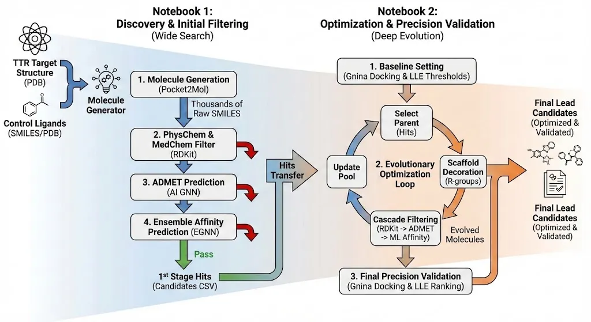
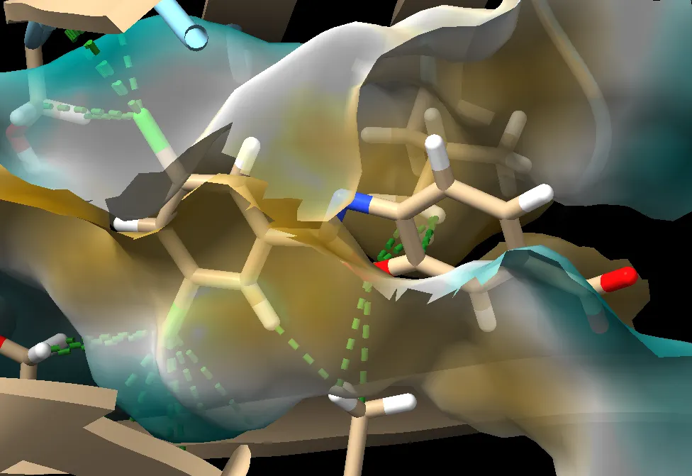

# 🧬 End-to-End AI Drug Discovery Pipeline for Rare Diseases
> TTR 아밀로이드증(TTR Amyloidosis) 표적에 분자를 생성하고 예측 모델로 좁히는 End-to-End 파이프라인

  

> ### ⚠️ 먼저 읽어 주세요 — 공개 후에 발견한 것
>
> 둘입니다.
>
> **1. 생성 후보 34개 중 16개(47%)에 고리 내 알렌(C=C=C)이 있습니다** — 최종 후보 MOL_1282 도
> 포함입니다. 합성 가능성 검토를 통과하지 못하는 배열이므로, 이 후보들을 "발굴한 화합물"로
> 읽으면 안 됩니다.
>
> **2. 대조군이 tafamidis 가 아니었습니다.** 대조군 SMILES 가 PDB 파일에서 결합 차수 없이 읽혀
> 방향족 고리가 전부 포화된 구조로 바뀌어 있었습니다(실제 tafamidis 와 Tanimoto 0.078).
> 따라서 **"대조군 대비 개선" 비교는 성립하지 않습니다.**
>
> 자세한 내용은 아래 **한계** 절에 적었습니다.
> 그 뒤 같은 표적을 평가 쪽부터 다시 세운 작업은 [rbfe-campaign-tyk2-ttr](https://github.com/Nudge92/rbfe-campaign-tyk2-ttr) 에 있습니다.

## 📖 프로젝트 개요 (Overview)
본 프로젝트는 **생성형 AI(Generative AI)와 진화 알고리즘**을 결합하여 **TTR 아밀로이드증** 표적의 결합 포켓에 맞는 분자를 생성하고, 예측 모델로 걸러 후보를 좁히는 End-to-End 파이프라인입니다. 생성 모델을 실제 표적에 붙여 끝에서 끝까지 돌려 보는 것이 목적이었습니다.

### 🎯 무엇을 만들었나 (What was built)
* **생성:** 포켓 조건부 3D 생성 모델(Pocket2Mol)로 TTR 결합 포켓에 분자 생성
* **여과:** 물리화학 필터 → 자체 학습한 결합친화도 예측 모델(EGNN 3-seed 앙상블) → Gnina 도킹
* **최적화:** 유전 알고리즘으로 적합도(예측 효능 + 예측 안전성) 반복 개선
* **산출:** 최종 후보 34건의 예측값 표 ([`results/final_candidates.csv`](./results/final_candidates.csv))

★ 아래 표의 pKd·hERG 는 **모두 모델 예측값**이며 측정값이 아닙니다.

---

## 🏗 파이프라인 아키텍처 (Pipeline Architecture)
이 파이프라인은 크게 **탐색(Discovery)**과 **최적화(Optimization)** 두 단계로 구성됩니다.




### 1. Data Preparation
* **Dataset Construction:** 단백질-리간드 복합체 데이터를 수집하고, 학습/검증 데이터셋의 구조적 다양성을 확보하기 위해 **Murcko Scaffold Split**을 수행했습니다.
* **Pocket Definition:**
    * PDB(Protein Data Bank)에서 TTR 결정 구조(Crystal Structure)를 확보했습니다.
    * **UCSF ChimeraX**를 활용하여 단백질 구조를 시각화하고, 공동 결정된(Co-crystallized) 리간드 좌표를 기반으로 결합 포켓(Binding Pocket)의 3D 좌표를 정밀하게 정의했습니다.

### 2. Generative Model Architecture (Pocket2Mol)
* **Architecture Overview:** 타겟 포켓의 기하학적 구조에 딱 맞는 분자를 생성하기 위해 **E(3)-Equivariant Graph Neural Network (GNN)** 기반의 **Pocket2Mol**을 활용했습니다.
* **Mechanism:**
    * **Encoder:** 포켓 원자들의 공간 좌표와 화학적 특징을 캡처하며, 회전 및 이동 불변성(Rotational and Translational Invariance, E(3)-symmetry)을 유지합니다.
    * **Decoder:** 포켓의 기하학적 임베딩을 조건(Condition)으로 받아, 높은 결합력을 가질 것으로 예측되는 리간드를 원자 단위(Atom-by-atom)로 생성합니다.

### 3. Screening & Optimization Strategy (The Loop)
생성된 분자들은 다단계 필터링 및 최적화 과정을 거칩니다:
1.  **Generation:** 생성 모델을 사용한 초기 분자 샘플링.
2.  **1st Filtering (Physicochemical):** ADMET 특성, QED(약물 유사성), SA Score(합성 가능성), RDKit Descriptors를 기반으로 1차 필터링 수행.
3.  **2nd Filtering (Affinity):** 자체 개발한 GNN 기반 예측 모델을 통해 결합력 예측.
4.  **Validation:** 딥러닝 기반 도킹 툴인 **Gnina**를 사용하여 결합 모드 및 스코어 최종 검증.
5.  **Evolutionary Optimization:**
    * 선별된 고득점 후보물질을 **유전 알고리즘(Evolutionary Algorithm)**에 투입.
    * 시스템이 반복적으로 분자를 변형(Mutation) 및 최적화하여 적합도 점수(Fitness Score = 효능 + 안전성)를 극대화하는 폐루프(Closed-loop) 구조.

### 4. Scoring & Validation Models (Critic)
생성-최적화 루프 내에서 "Critic" 역할을 수행하는 커스텀 GNN 모델을 개발했습니다:
* **Binding Affinity Model:** pKd 값을 예측하여 약물의 효능(Potency) 추정.
* **ADMET Model:** hERG 저해와 같은 독성 리스크 및 약동학적 프로필 예측.

---

## 🧪 핵심 기술 (Technical Highlights)

### 1. Hybrid GNN for ADMET
* **문제:** 기존 GNN은 분자 구조만 학습하여 구체적인 물리화학적 특성을 놓칠 수 있음
* **해결:** 구조적 임베딩(GNN)에 **15가지 물리화학적 특징(Descriptors)**을 결합(Concatenation)
* **기록된 값:** 노트북 출력에 남은 AUC 는 **0.446 ~ 0.826** 범위이고 중앙값은 **0.769** 입니다(804개 기록).
  0.789 도 그중 하나이므로, 단일 값을 대표 성능으로 읽지 마십시오.

### 2. Scaffold Split Validation
* **문제:** Random Split은 구조가 비슷한 분자에 과적합(Overfitting) 발생 가능
* **해결:** **Murcko Scaffold Split**을 적용하여 학습/검증 데이터의 골격을 분리
* **결과:** "보지 못한 구조(Novel Structure)"에 대한 일반화 성능(Generalization) 확보

### 3. Engineering Optimization
* **Ensemble:** 3-Seed Ensemble로 예측 편향(Bias) 최소화
* **Gradient Accumulation:** 제한된 GPU 메모리에서 배치 사이즈 효율화

---

## 실험 환경 (Experimental Setup)
To enable efficient training and inference of 3D-GNN models, I built a custom deep learning environment from scratch.

* **Hardware (Custom Workstation):**
    * **GPU:** NVIDIA GeForce RTX 4060 Ti (8GB VRAM)
    * **CPU:** AMD Ryzen 7 7700 8-Core Processor
    * **RAM:** 32GB
* **Software Environment:**
    * **OS:** Linux (Ubuntu 22.04 LTS) - configured for optimal GPU utilization.
    * **CUDA Version:** 12.9 (Driver Support)
* **Engineering Highlights:**
    * **Dependency Management:** Replaced Conda with **Mamba** to resolve complex dependency conflicts between `rdkit`, `pytorch-geometric`, and `biopython`, reducing environment setup time by **90%**.
    * **Troubleshooting:** Resolved `CUDA device-side assert` errors caused by graph dimension mismatches during the training of GNN layers (Documented in `Debugging_log.ipynb`).

## 📊 실험 결과 (Results)

최종 후보로 골랐던 분자는 MOL_1282 입니다. 아래는 `results/final_candidates.csv` 의 값 그대로입니다.

| 구분 | ⚠ 대조군 행 (`LIG_Tafamidis`) | ⚠ 최종 후보 (MOL_1282) |
| :--- | :---: | :---: |
| **Potency (pKd)** — 예측값 | 5.269 | 7.847 |
| **Efficiency (LLE)** — 예측값 기반 | 3.47 | 5.49 |
| **Toxicity (hERG)** — 예측값 | 0.67 | 0.25 |
| **Similarity (vs Tafa)** | 1.0 | 0.139 |

> ⚠ **왼쪽 열** — 이 값들은 **화학적으로 유효하지 않은 구조**에서 계산됐습니다.
> 대조군 행의 SMILES 는 방향족 고리 **0개**, 카복실산 **0개**이고 실제 tafamidis 와
> **Tanimoto 0.078** 입니다(한계 2).
>
> ⚠ **오른쪽 열** — 이 분자는 **고리 내 알렌(C=C=C)을 1개 담고 있습니다.**
> 합성 가능성 검토를 통과하지 못하는 배열입니다(한계 1).

★ 따라서 이 표를 **"대조군 대비 개선"으로 읽으면 안 됩니다.** 두 열은 같은 모델이 서로 다른 두
분자에 매긴 예측값일 뿐이고, 왼쪽은 실제 약물의 값이 아니며 오른쪽은 합성 가능한 분자가 아닙니다.



*Figure 1. MOL_1282 의 도킹 포즈.*

### 📋 전체 후보물질 리스트 (Full Candidates Data)
최종 선별된 34개 후보물질의 상세 물성 데이터(SMILES, pKd, LLE, hERG 등)는 아래 링크에서 확인할 수 있습니다.

👉 **[전체 34개 후보물질 리스트 확인하기](./results/final_candidates.csv)**

---

## ⚠️ 한계 — 공개 후에 발견한 것

아래 넷은 저장소를 공개한 뒤에 찾았습니다. 고치지 않고 그대로 적습니다.

### 1. 생성 후보의 47% 가 합성 가능성 검토를 통과하지 못한다 — 가장 큰 문제

생성 후보 34개 중 **16개(47%)** 가 고리 안에 알렌(C=C=C)을 담고 있습니다.
이 배열은 작은 고리에서 각 변형이 커서 합성 가능성 검토를 통과하지 못합니다.
**최종 후보로 고른 MOL_1282 에도 고리 내 알렌이 1개 있습니다.**
생성 단계에서 화학적 타당성 필터를 걸지 않은 결과입니다.

이것을 한계의 첫 항목에 둔 이유는, 대조군 문제(한계 2)가 "비교가 성립하지 않는다"는 뜻인 데 비해
이것은 **"생성물 자체가 성립하지 않는다"**는 뜻이기 때문입니다.

### 2. 대조군이 tafamidis 가 아니다

`results/final_candidates.csv` 의 `LIG_Tafamidis` 행에 담긴 SMILES 는 tafamidis 의 구조가 아닙니다.

| | 저장소의 대조군 행 | 실제 tafamidis |
|---|---|---|
| 분자식 | `C14H23Cl2NO3` | `C14H7Cl2NO3` |
| 방향족 고리 | **0개** | 3개 |
| 카복실산 | **0개** (제미날 다이올) | 1개 |

두 구조의 Morgan(r=2) **Tanimoto 유사도는 0.078** 입니다 — 사실상 다른 분자입니다.

**원인:** 대조 리간드를 `data/sample_inputs/ligand/tifamidis.pdb`(PDB 리간드 코드 `3MI`)에서 읽었는데,
**PDB 형식은 결합 차수를 담지 않습니다.** 결합 차수 인식 없이 SMILES 로 변환하면서 방향족 고리가
전부 단일결합으로 포화되고 카복실산의 C=O 가 C–OH 로 바뀌었습니다.

**영향:**
* 대조군 `pKd 5.269` 는 tafamidis 의 예측값이 아니라 **위 변형된 구조의 예측값**입니다.
* `Similarity (vs Tafa) 0.139` 로 주장한 신규성도 **변형된 구조를 기준으로 잰 값**입니다.
* 따라서 "기존 약물 대비 개선"이라는 비교는 성립하지 않습니다.

### 3. `Potency (pKd)` 는 측정값이 아니라 모델 예측값이다

열 이름이 측정값처럼 읽히지만, 이 값은 자체 학습한 **EGNN 3-seed 앙상블**
(`egnn_seed41/42/43.pt`)의 예측입니다. 학습 라벨은 **PDBbind refined set (2016)** 의 실험
결합상수이고(`02_Models/Binding_Affinity/configs/binding_affinity_optimized.yaml`),
추론 대상은 TTR 포켓에 도킹한 생성 분자입니다. 예측기의 적용 범위(applicability domain)를
확인하지 않았습니다.

### 4. hERG AUC 를 단일 값으로 적었다

본문에 적었던 `ROC-AUC 0.789` 는 노트북 출력에 실제로 남아 있는 값이지만,
같은 출력에 기록된 AUC 는 **804개이고 0.446 ~ 0.826 에 퍼져 있습니다**(중앙값 0.769).
그중 하나를 골라 대표 성능으로 적은 것이었습니다.

---

### 그 뒤에 한 일

위 넷은 **만드는 쪽(생성)을 믿고 평가 쪽을 세우지 않아서** 생긴 문제입니다.
그래서 같은 표적(TTR)으로 **평가 쪽을 다시 세웠습니다** — 상대결합 자유에너지(RBFE) 계산을
사전 등록하고, 참값이 0 인 공시험을 넣고, 그 공시험이 사전 등록한 문턱을 넘지 못하자
**후보 순위를 보고하지 않았습니다.**

→ **https://github.com/Nudge92/rbfe-campaign-tyk2-ttr**

---

## 🛠 기술 스택 (Tech Stack)
* **Languages:** Python
* **Environment:** Anaconda (Conda), Python 3.8
* **AI/ML:** PyTorch, PyTorch Geometric, Optuna
* **Cheminformatics:** RDKit, OpenBabel
* **Bioinformatics:** PyMOL, ChimeraX, Gnina, Pocket2Mol
* **Tools:** Jupyter Lab, Datawarrior

---

## 📂 프로젝트 구조 (Directory Structure)

```text
├── 01_Pipeline/                 # 메인 실행 파이프라인
│   ├── B_Run_Pipeline.ipynb     # Phase 1: 초기 탐색 및 필터링
│   ├── G_DrugPipelineCycle.ipynb # Phase 2: 진화적 최적화 사이클
│   ├── config/                  # 설정 파일
│   └── utils/                   # 유틸리티 함수
├── 02_Models/                   # 모델 학습 및 평가 연구용 (Research)
│   ├── ADMET/                   # 독성/물성 예측 모델
│   ├── Binding_Affinity/        # 결합력 예측 모델
│   └── Pocket2Mol/              # 분자 생성 모델
├── models/                      # 학습 완료된 모델 가중치 (.pt 파일)
├── data/                        # 입력 데이터 (PDB 등)
└── requirements.txt             # 의존성 패키지
```

---

## 🚀 설치 및 실행 (Installation & Usage)

본 프로젝트는 **Generative Model(Pocket2Mol)**과 **Predictive Model(DrugAI)**의 라이브러리 버전 호환성을 위해 **두 개의 독립된 Conda 가상환경**을 사용합니다.

### 1. 환경 설정 (Environment Setup)

먼저 리포지토리를 복제하고, 제공된 `.yml` 파일을 이용해 두 개의 가상환경을 생성합니다.

```bash
# 1. Repository 복제
git clone [https://github.com/username/rare-disease-drug-discovery.git](https://github.com/username/rare-disease-drug-discovery.git)
cd rare-disease-drug-discovery

# 2. 'Pocket2Mol' 환경 설치 (분자 생성용)
conda env create -f environment_pocket2mol.yml

# 3. 'drugai' 환경 설치 (물성 예측 및 최적화용)
conda env create -f environment_drugai.yml
```

---

### 2. 파이프라인 실행 (Run Pipeline)

이 파이프라인은 Jupyter Notebook으로 실행됩니다. 단계에 맞춰 **알맞은 가상환경을 활성화(Activate)**한 후 노트북을 실행해 주세요.

#### **Step 1: 후보물질 생성 및 1차 필터링 (Phase 1)**
* **사용 환경:** `Pocket2Mol` (또는 `drugai` - *본인이 사용하는 환경에 맞춰 선택*)
* **실행 파일:** `01_Pipeline/B_Run_Pipeline.ipynb`
* **실행 방법:**
  ```bash
  conda activate Pocket2Mol
  jupyter lab
  # 위 노트북을 열어서 실행
  ```
* **기능:** TTR 타겟 구조를 기반으로 새로운 분자를 생성하고, 기본적인 물리화학적 필터링을 수행합니다.

#### **Step 2: 진화적 최적화 및 최종 검증 (Phase 2)**
* **사용 환경:** `drugai`
* **실행 파일:** `01_Pipeline/G_DrugPipelineCycle.ipynb`
* **실행 방법:**
  ```bash
  conda activate drugai
  jupyter lab
  # 위 노트북을 열어서 실행
  ```
* **기능:** Step 1에서 선별된 물질을 시드(Seed)로 하여, 유전 알고리즘(Genetic Algorithm)을 통해 효능과 안전성을 최적화합니다.

---

### 3. 개별 모델 학습 (Optional)
모델 연구 및 재학습을 위해서는 `drugai` 환경을 사용합니다.
* **ADMET 모델:** `02_Models/ADMET/notebooks/ADMET_model_eval.ipynb`
* **결합력(Affinity) 모델:** `02_Models/Binding_Affinity/notebooks/binding affinity(ML).ipynb`

---
